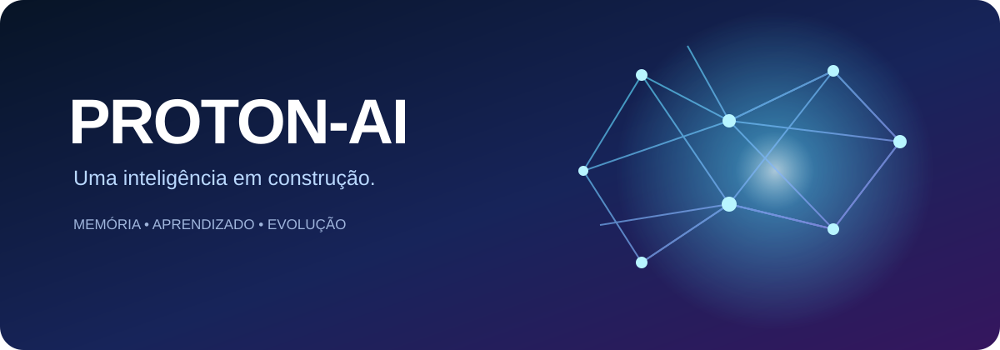

# 🧠 Proton-AI



<p align="center"><strong>Uma inteligência artificial experimental, construída para aprender, organizar conhecimento e evoluir com segurança.</strong></p>

<p align="center">
  
  
  
  
</p>

**Proton-AI** é um projeto aberto para desenvolver uma inteligência artificial própria por etapas. A versão inicial oferece memória local, comandos no terminal, interface gráfica no navegador e três verificações locais independentes para revisar anotações antes de salvá-las. O objetivo futuro é pesquisar arquiteturas, treinar e avaliar modelos próprios e adicionar agentes especializados.

> **Importante:** esta é a fundação inicial do projeto, não um modelo de linguagem já treinado. A memória desta versão salva e recupera anotações; ela ainda não aprende pesos de uma rede neural nem conversa com a capacidade de um grande chatbot.

## ✨ Recursos e estado atual

| Recurso | Situação |
| --- | --- |
| Memória local de conhecimentos | 🟢 Implementada |
| Aprender anotações com revisão estrutural local | 🟢 Implementado |
| Consultar conhecimentos salvos | 🟢 Implementado |
| Interface de terminal | 🟢 Implementada |
| Interface gráfica local | 🟢 Implementada |
| Verificadores locais independentes (não são LLMs) | 🟢 Implementados |\n| Agentes professores baseados em modelos de IA | 🟡 Planejado |
| Treinamento de modelo próprio | 🟡 Planejado |
| Pesquisa online com fontes | 🟡 Planejado |
| Atualização validada e reversão | 🟡 Planejado |

## 📱 Instalação no Android (Termux)

1. Instale o [Termux](https://termux.dev/) por uma fonte confiável.
2. Abra o Termux e execute cada comando:

```bash
pkg update
pkg install git python
git clone https://github.com/brawlstarsarthurgg415-byte/Proton-AI.git
cd Proton-AI
```

3. Inicie a versão de terminal:

```bash
python -m proton.cli
```

4. Para usar a interface gráfica, encerre o terminal com `/quit` e execute:

```bash
python -m proton.web
```

5. Abra o navegador no mesmo aparelho e visite **http://127.0.0.1:8765**.

No Linux, instale Git e Python 3.11 ou superior e siga os mesmos passos.

## 💬 Como usar

No terminal, experimente:

```text
/help
/learn A água é formada por hidrogênio e oxigênio.
/ask De que é formada a água?
/list
/quit
```

- `/learn texto`: envia uma anotação para três verificações locais (clareza básica, origem e duplicidade); se passar, salva na memória.
- `/ask pergunta`: procura anotações relacionadas à pergunta.
- `/list`: mostra os conhecimentos salvos.
- `/help`: mostra os comandos disponíveis.
- `/quit`: encerra o Proton.

Na interface gráfica, escreva uma informação e toque em **Ensinar ao Proton**. Para consultar, escreva uma pergunta e toque em **Perguntar**. O botão **Ver memória** lista as anotações.

## 🧩 Como modificar

O projeto está dividido em arquivos pequenos:

| Caminho | Para que serve |
| --- | --- |
| `proton/core.py` | lógica de consulta |\n| `proton/learning.py` | fluxo de entrada e revisão de anotações |\n| `proton/teachers/local.py` | verificadores locais executados em paralelo |
| `proton/memory.py` | gravação e leitura da memória |
| `proton/cli.py` | interface de terminal |
| `proton/web.py` | interface gráfica local |
| `tests/` | testes automáticos |
| `assets/` | imagens do projeto |

Para alterar o comportamento, abra o arquivo relacionado, faça uma mudança pequena e execute os testes:

```bash
python -m unittest discover -s tests
```

Se os testes passarem, os comportamentos cobertos continuam funcionando. Isso não garante que toda mudança esteja perfeita; leia o código e teste também o recurso alterado.

## 🗂️ Estrutura do projeto

```text
-Proton-AI/
├── assets/
├── data/                 # criada localmente ao executar
├── proton/
│   ├── core.py
│   ├── memory.py
│   ├── cli.py
│   └── web.py
├── tests/
├── .github/workflows/
├── .gitignore
├── LICENSE
├── README.md
└── requirements.txt
```

## 🔐 Privacidade e segurança

- A memória fica no aparelho, dentro de `data/knowledge.json`.
- A pasta `data/` é ignorada pelo Git para não publicar suas anotações pessoais.
- Nunca publique senhas, tokens ou chaves de API.
- A interface web escuta somente em `127.0.0.1`, isto é, no próprio aparelho.
- As verificações locais não validam a verdade de uma informação. Esta versão não baixa nem executa atualizações automaticamente.
- Futuras pesquisas online deverão guardar fontes e tratar páginas externas como conteúdo não confiável.

## 🧪 Testes

```bash
python -m unittest discover -s tests
```

## 🤝 Como contribuir

1. Faça um fork ou uma cópia do repositório.
2. Crie uma mudança pequena e explique o motivo.
3. Execute os testes.
4. Envie uma proposta descrevendo o que mudou e como testar.

## 📜 Licença

O projeto usa a licença MIT. Leia o arquivo [LICENSE](LICENSE).

---

<p align="center"><strong>Proton-AI — aprendendo passo a passo.</strong><br><sub>Projeto experimental: recursos planejados não são recursos já implementados.</sub></p>
